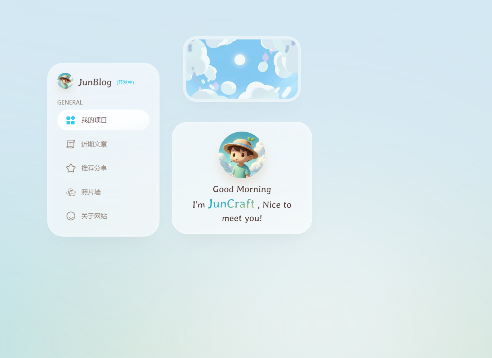

# JunBlog



JunCraft 的个人博客。记录鸿蒙开发、探索和笔记。

> 本项目是跟着教程做的个人博客，基于 [YYsuni/2025-blog-public](https://github.com/YYsuni/2025-blog-public)（MIT 协议）改造。原项目是一个开箱即用的现代化个人博客模板，我在它的基础上改了后端、改了部署方式，文章和数据全部存在自己的服务器上，不再依赖 GitHub。

## 在线地址

- 博客：http://junblog.cloud-ip.cc/ （经 frpc 内网穿透对外访问）

## 它能做什么

- **打开博客直接写文章**：在博客后台点“写文章”，写完保存立刻就能看到，不用重新构建、不用经过 GitHub。
- **文章和数据都在自己的服务器上**：文章、图片、站点设置（社交按钮、自定义歌曲、首页图片等）全部存在自己的服务器，不依赖第三方平台。
- **点赞**：首页点赞默认从 100 开始计数，数据存在自家后端。
- **自定义歌曲**：后台可以上传一首 mp3 或填入 mp3 链接，首页音乐卡片播放它；进照片墙等其他页面时音乐不断，播放器移到右下角。
- **照片墙**：/pictures，照片可以拖动摆放。
- **手机端适配**：窄屏下首页是单独的布局（汉堡导航、底部音乐条），不被宽屏布局打乱。

## 技术栈

- 前端：Next.js 16（静态导出，`output: 'export'`）、React、TypeScript、Tailwind CSS、Motion
- 后端：自研 Go 后端（`backend/`，标准库，无第三方依赖，内存约 9MB），提供文章、图片、点赞、设置等接口
- 部署：Nginx（80 端口）托管静态站并反代 `/api/` 到后端；后端用 systemd 常驻；经 frpc 内网穿透对外访问
- 服务器：一台免费小服务器（1 vCPU / 256MB 内存 / 1GB 磁盘，Debian），博客和后端加起来只占几十 MB

## 目录结构

- `src/`、`public/`、`next.config.ts` 等：前端（Next.js 16）
- `backend/`：Go 后端（`main.go`、`go.mod`，说明见 `backend/README.md`）
- `data/`：站点数据种子（about、bloggers、projects、share、site-content 等 8 个 JSON），首次部署时复制到网站根目录
- `public/blogs/`：文章（`{slug}/config.json + index.md`），图片按 SHA-256 命名去重
- `cover.png`：本 README 的封面图（博客首页截图）

## 本地运行

前端：

```bash
pnpm install
pnpm build   # 生成 out/
```

后端：

```bash
cd backend
go build -o blog-api
./blog-api -data ../public/blogs -site-dir .. -account-file admin.json -addr 127.0.0.1:8081
```

`admin.json` 是管理员账号文件（用户名 + 加盐密码哈希），不要提交到仓库，部署时在服务器上生成。

## 部署到服务器

Nginx（80 端口）托管静态站并反代 `/api/` 到后端；后端用 systemd 常驻。详细步骤见部署文档（不放在仓库里，含管理员密码）。

部署时注意：

- 不要覆盖服务器上的 `data/`（站点设置、照片、文章数据都是最新的，包里只是种子）。
- 不要删除服务器上的 `music/` 和 `images/`（用户上传的歌曲和图片在里面）。
- 改内容（文章、图片、站点设置）不用重新构建，后台保存立刻生效；改代码、样式、布局才需要重新构建和部署。

## 说明

- 原项目作者的 75 篇示例文章已清空；当前只有一篇迁移文章。
- `public/images/` 下的图片（png/jpg/webp）和文章封面图因格式原因未包含在本次提交中，后续补充。
- License：MIT（沿用原项目）
